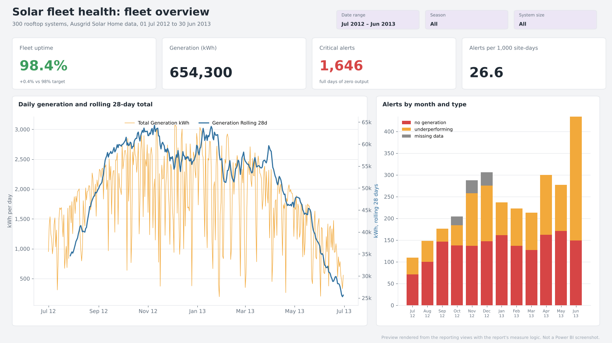
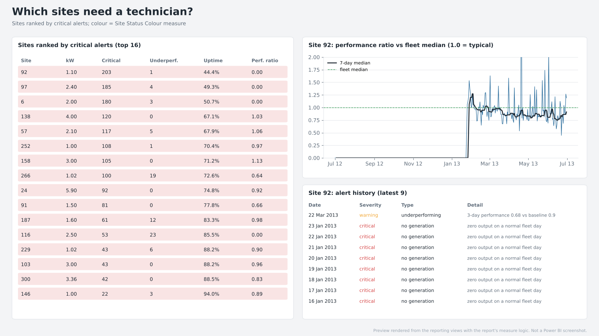
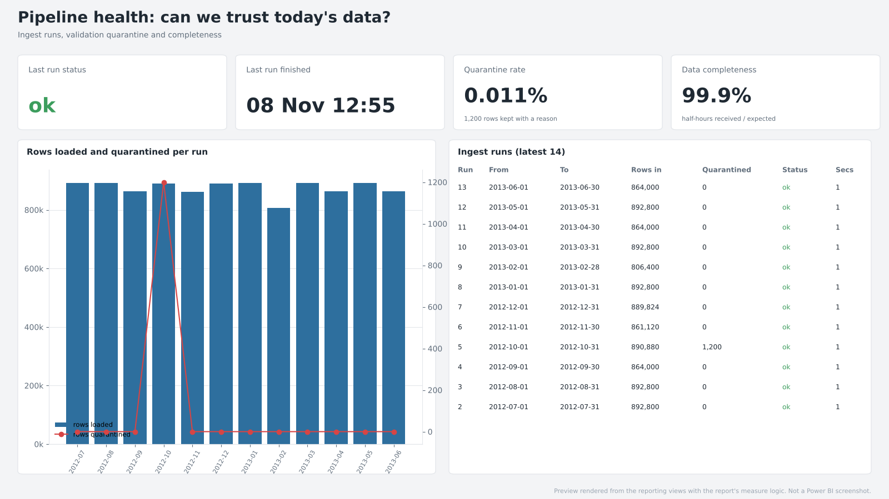
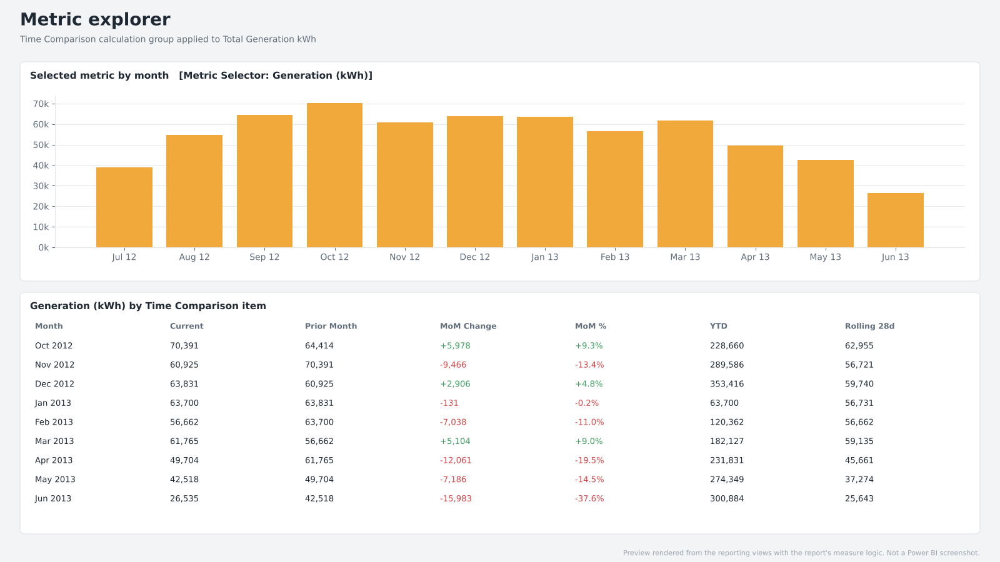

# Power BI: Solar fleet health report

A Power BI report on top of the PostgreSQL pipeline in this repo, saved as a **Power BI Project
(PBIP)**. The semantic model is in TMDL and the report is in PBIR, so every table, measure,
relationship and visual is a plain text file that can be diffed, reviewed and tested in CI like
the rest of the code.

It answers the questions a fleet operations team asks every morning: **is the fleet up, which
sites need a technician, and can we trust today's data?**



## Three ways to look at it

| If you want to… | Look at |
|---|---|
| **See the dashboard with real numbers** | [`preview/`](preview/). Each page rendered from the real data (10.5M readings, 300 sites) by `tools/render_preview.py`, using the same reporting views and the same logic as the DAX measures. Drawn with matplotlib, not screenshots from Power BI. |
| **Read the DAX** | [`measures.dax`](measures.dax): all 28 measures, the calculation group and the RLS filter in one file. |
| **Open it in Power BI Desktop** | `SolarFleetHealth.pbip` (see "Open and refresh" below). |

## Architecture

```
Ausgrid CSV ─► Python pipeline ─► PostgreSQL tables ─► reporting.* views ─► Power BI semantic model ─► 4 report pages
               (validate, load)   readings, alerts      star schema          (TMDL, Import mode)
```

| Layer | Where | Notes |
|---|---|---|
| Reporting views | `sql/reporting_views.sql` | Created on every pipeline run. Power BI never reads raw tables, so the pipeline can change without breaking the report. Flags like `is_outage_day` are computed in SQL, so the DAX stays simple. |
| Read-only login | `powerbi_reader` | Can read the `reporting` schema only (tested: it is refused on `readings`). |
| Semantic model | `SolarFleetHealth.SemanticModel/definition/` | Star schema, 28 measures, a calculation group, a field parameter, dynamic RLS. |
| Report | `SolarFleetHealth.Report/definition/` | 4 pages, 26 visuals, custom theme. |
| Preview | `tools/render_preview.py` | Renders each page from the real data so the report can be reviewed without Power BI. |
| Tests | `tests/test_powerbi_model.py` | Fails CI if a visual or DAX expression references a column or measure that no longer exists. |

## Semantic model

**Star schema.** Two fact tables share two conformed dimensions, all relationships one-to-many
and single-direction (no bidirectional filters, so no ambiguous paths).

| Table | Grain | Role |
|---|---|---|
| `fact_daily` | site × day | Generation, consumption, yield, performance ratio, health flags |
| `fact_alerts` | one alert | Type, severity, detail |
| `dim_site` | site | Capacity, capacity band, postcode, alert totals |
| `dim_date` | day | Gap-free calendar, marked as the date table, `Calendar` hierarchy (year › month › date), southern-hemisphere seasons |
| `pipeline_runs` | ingest batch | Standalone, for the pipeline health page |
| `site_access` | login × postcode | Hidden security table for row-level security |

**Modelling choices**

- **Auto date/time is off** and `dim_date` is marked as the date table, so time intelligence uses one shared calendar instead of a hidden date table per date column.
- **Implicit measures are disabled** (`discourageImplicitMeasures`). Every number in the report comes from an explicit, documented measure.
- **Keys and flag columns are hidden**, so report authors see only fields that make sense to drag onto a visual.
- **Sort-by columns**: `month_label` sorts by `month_start`, `weekday` by `weekday_no`, `severity` by `severity_order` (critical first).
- **Parameterised source**: `PgServer` and `PgDatabase` are Power Query parameters, so pointing the report at another server is one change.
- **Descriptions** on every table and measure (`///` lines) show as tooltips in the Fields pane.

## DAX measures

All 28 are in [`_Measures.tmdl`](SolarFleetHealth.SemanticModel/definition/tables/_Measures.tmdl), grouped into display folders (Base, Uptime, Alerts, Performance, Time intelligence, Pipeline, Formatting). The ones worth explaining:

| Measure | What it does and why |
|---|---|
| `Expected Site Days` | `CROSSJOIN` of site and date dimensions in the current filter. Built from dimensions, not the fact table, so a site that sent no data still counts. Otherwise missing data would quietly *raise* uptime. |
| `Fleet Uptime %` | 1 − (outage days + missing-data days) ÷ expected site days, using variables. An outage is a full day of zero output while the fleet generated normally, so cloudy days are not downtime. |
| `Alerts per 1,000 Site-Days` | Normalises alert volume by fleet size and period length. Same unit as the detector's false-alarm rate (9.2 per 1,000) in the main README. |
| `Critical Alerts` | `CALCULATE` with `KEEPFILTERS`, so a severity slicer narrows the result instead of being overwritten. |
| `Median Performance Ratio` | Median, not mean, so a few dead sites at 0 don't drag down the fleet figure. |
| `Site Rank by Alerts` | `RANKX` over `ALLSELECTED` sites, guarded by `HASONEVALUE` so totals stay blank instead of showing a meaningless rank. |
| `Generation Rolling 28d` | `DATESINPERIOD` over the date table. Matches the 28-day baseline the fault detector uses. |
| `Generation MoM %` / `YTD` | `DATEADD` and `TOTALYTD`, with `DIVIDE` to avoid divide-by-zero in the first month. |
| `Last Run Status` | Finds the highest `run_id`, then returns that run's status: did the latest load succeed? |
| `Site Status Colour` | `SWITCH ( TRUE (), … )` returns a hex colour used for conditional formatting in the site table: red = critical, amber = underperforming, green = healthy. |

**Calculation group: `Time Comparison`.** Current, Prior Month, MoM Change, MoM %, YTD and Rolling 28d, each written once with `SELECTEDMEASURE ()` and applied to any measure. MoM % uses a dynamic format string so it shows as a percentage whatever the base measure's format. This replaces writing six variants of every measure by hand.

**Field parameter: `Metric Selector`.** A slicer lets the viewer choose which KPI the trend chart plots (generation, uptime, alert rate, performance ratio or completeness) without duplicating the visual.

**Row-level security.**

| Role | Access |
|---|---|
| Fleet Operations | All sites |
| Postcode Manager | Only postcodes mapped to their login in `reporting.site_access`, via `USERPRINCIPALNAME ()`. Facts are filtered automatically through the relationships. |

## Report pages

| Page | Purpose | Visuals |
|---|---|---|
| Fleet overview | Is the fleet up? | KPI cards (uptime, generation, critical alerts, alert rate); daily generation with rolling 28-day line; alerts by month stacked by type; slicers for date range, season, system size |
| Site drill-down | Which sites need a technician? | Site table sorted by critical alerts with status-colour background; performance-ratio trend; alert history |
| Pipeline health | Can we trust the data? | Last run status and time, quarantine rate, completeness; rows loaded vs quarantined per run; run log |
| Metric explorer | Self-service analysis | Field-parameter slicer driving a monthly trend; matrix of generation across the Time Comparison calculation group |

<p>


</p>


## Open and refresh

1. Load the data from the repo root: `docker compose up -d` then `python -m fleethealth backfill`.
2. Open `powerbi/SolarFleetHealth.pbip` in Power BI Desktop.
3. Sign in to PostgreSQL with the *Database* option: `powerbi_reader` / `powerbi_reader`, then **Refresh**.

To use another server, change `PgServer` under *Transform data › Edit parameters*.

## Folder layout

```
powerbi/
├── SolarFleetHealth.pbip                    entry point: open this in Power BI Desktop
├── SolarFleetHealth.SemanticModel/
│   └── definition/
│       ├── model.tmdl  database.tmdl  relationships.tmdl  expressions.tmdl
│       ├── tables/     one .tmdl per table (measures in _Measures.tmdl)
│       └── roles/      row-level security
├── SolarFleetHealth.Report/
│   ├── definition/pages/<page>/visuals/<visual>/visual.json
│   └── StaticResources/RegisteredResources/SolarFleetTheme.json
├── measures.dax                             all DAX in one readable file
├── tools/render_preview.py
└── preview/                                 pages rendered from the real data
```
